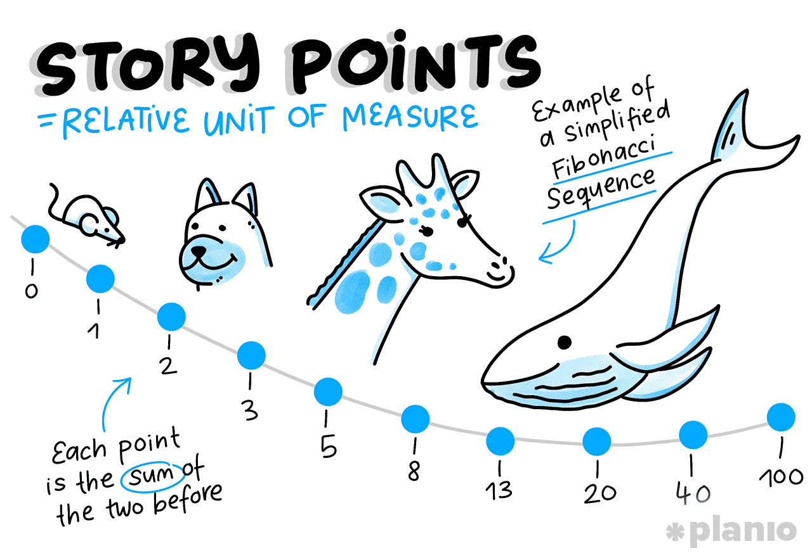
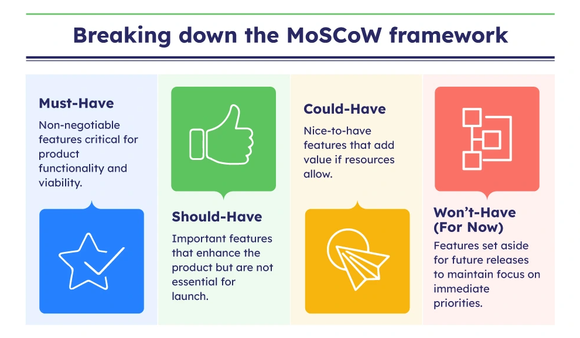

# 3.1 Project Management

## Methodology

The project is managed with Scrum in three four-week sprints plus a closure phase. The backlog, story status and sprint reviews are kept on this site instead of in Jira: in Semester 3 the experts had no Jira access, so every sprint artefact had to be duplicated here anyway. Day-to-day progress is traceable through the Git commit history and the GitHub Actions runs of this repository.

---

## Story Points with Fibonacci

Story points use the Fibonacci sequence (1, 2, 3, 5, 8, 13) to express relative complexity. The calibration from Semester 3 is kept: about 2 story points per hour (102 points delivered for ~51 hours).

---

## Prioritisation with MoSCoW

| Priority | Stories | Reason |
|---|---|---|
| Must have | G1, G2, G5 and all planning, documentation and review stories | G1 is the base everything else runs on. G2 and G5 are the two problems from Semester 3 that the project exists to solve (no failover, manual schema changes) and cover both technical modules. |
| Should have | G3 scaling, G4 backup and PITR | Valuable, but the cluster and pipeline work without them. They sit in Sprint 3, which includes the Christmas holidays, and are reduced first if time runs out. |
| Could have | — | None committed. |
| Won't have | Write scaling/sharding, multi-cluster, automatic schema rollback | See [Out of Scope](../02_Assignment/201_task.md#out-of-scope). |

---

## Definition of Done

### Functionality and Implementation

- All acceptance criteria of the story are met.
- Manifests, migrations and pipeline files are committed to this repository; nothing exists only on the laptop.
- The result is reproducible from the repository.

### Documentation

- The result, the steps leading to it and the reasoning behind decisions are documented on this site.
- Configuration files are referenced, not copied in full.

### Quality Control

- Tests are run and the result is recorded in a test protocol.
- Failed tests are documented with cause and consequence, not removed.

---

## Release Planning

| Sprint | Release | Value delivered |
|---|---|---|
| 1 | MVP — Minimal Viable Product | SEM03 database runs on a 3-instance CNPG cluster; all schema tests pass |
| 2 | MLP — Minimum Lovable Product | Failover proven by test protocol; schema changes go through the pipeline |
| 3 | MMP — Minimal Marketable Product | Read scaling and point-in-time recovery proven; documentation complete |

---

## Project Organisation

| Name | Role | Contact |
|---|---|---|
| Juan Cardoso | Student / Scrum Master / Product Owner | MS Teams |
| Philip Stark | Subject Matter Expert — Kubernetes (CNC) | MS Teams |
| Florian Huber | Subject Matter Expert — Project Management | MS Teams |
| TBZ | Stakeholder / Assessment body | — |

---

## Stakeholder Analysis

| Name | Role | Attitude | Influence | Interest |
|---|---|---|---|---|
| Juan Cardoso | Student, development & documentation | High | Critical | Complete the project on time and meet all requirements |
| Philip Stark | Technical coach | Medium | Supporting | Depth of the Kubernetes and CI/CD implementation |
| Florian Huber | Project management coach | Medium | Supporting | Quality of the project management process |
| TBZ | Assessment body | Low | Neutral | Student success in the programme |

---

## Communication Plan

| Channel | Purpose |
|---|---|
| MS Teams | Primary communication with both experts |
| GitHub Pages | Documentation, backlog and sprint status — accessible to all parties |
| GitHub repository | Commits, pull requests and pipeline runs as evidence of progress |
| In person | Scheduled feedback sessions during class |

---

## Tools & Software

| Tool | Purpose |
|---|---|
| GitHub / GitHub Pages | Source code, documentation, backlog |
| GitHub Actions (self-hosted runner) | CI/CD pipeline |
| kind, kubectl | Local Kubernetes cluster |
| CloudNativePG | PostgreSQL operator |
| PostgreSQL + pgvector | Database (from SEM03) |
| Flyway | Versioned schema migrations |
| Python | Application service (from SEM03) |
| Docker | Container runtime for kind and images |
| VSCode | Editor |
