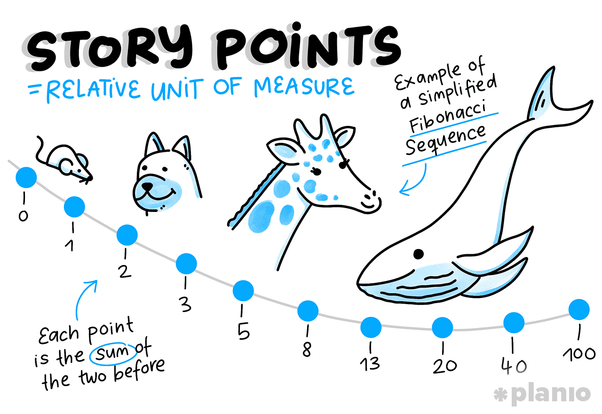
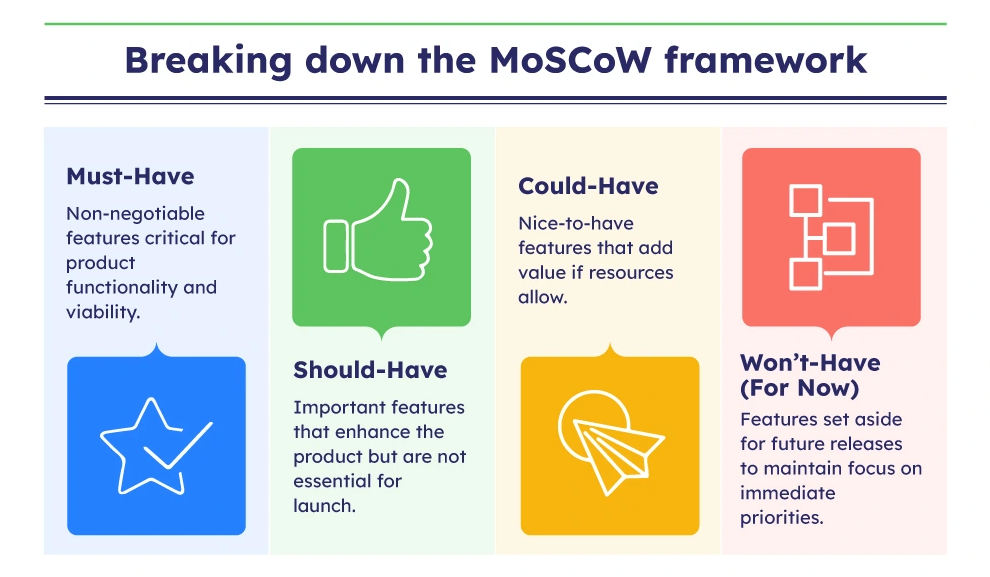
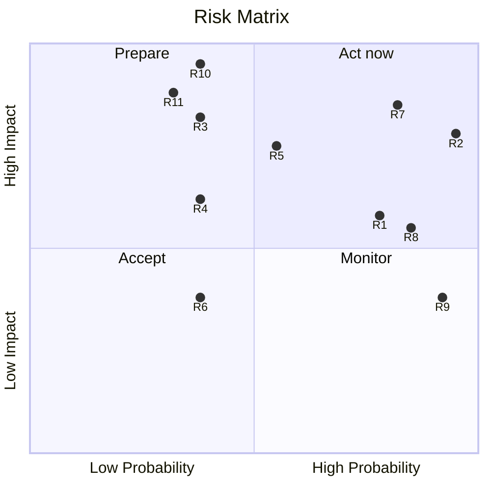

# 3.1 Project Management

## Methodology

The project is managed with Scrum in three four-week sprints plus a closure phase. The backlog, story status and sprint reviews are kept on this site instead of in Jira: in Semester 3 the experts had no Jira access, so every sprint artefact had to be duplicated here anyway. Day-to-day progress is traceable through the Git commit history and the GitHub Actions runs of this repository.

Every sprint contains planning, realisation (installation and tests), documentation and a risk assessment:

| Activity | Sprint 1 | Sprint 2 | Sprint 3 |
|---|---|---|---|
| Planning | 1.2–1.6 | 2.1, 2.2 | 3.1 |
| Installation | 1.7, 1.8, 1.10 | 2.4–2.7 | 3.2, 3.3 |
| Tests | 1.8, 1.9 | 2.3, 2.6, 2.7 | 3.2, 3.4 |
| Documentation | Per story (Definition of Done) | Per story, 2.8 theory | Per story, 3.5, 3.6 |
| Risk assessment | 1.4 | 2.1, review in 2.9 | 3.1, review in 3.7 |

Each component is tested in the sprint in which it is built. Test results and findings feed into the next sprint's planning and risk review and can change the backlog or the product.

---

## Product Backlog

| ID | Story | Goal | Sprint | Points | Priority | Status |
|---|---|---|---|---|---|---|
| 1.1 | Repository & GitHub Pages setup, SEM03 archived | — | 1 | 2 | Must | Done |
| 1.2 | Requirements, scope & backlog | — | 1 | 3 | Must | Done |
| 1.3 | Timeline (Gantt) | — | 1 | 2 | Must | Done |
| 1.4 | Risk analysis | — | 1 | 3 | Must | Done |
| 1.5 | Evaluation: Kubernetes distribution, operator, migration tool, object store | G1–G5 | 1 | 5 | Must | Done |
| 1.6 | System design & architecture | G1–G5 | 1 | 5 | Must | Open |
| 1.7 | kind cluster with 3 worker nodes | G1 | 1 | 3 | Must | Open |
| 1.8 | CNPG operator + Cluster manifest (1 primary, 2 replicas, anti-affinity) | G1 | 1 | 5 | Must | Open |
| 1.9 | Schema import incl. pgvector; `06_tests.sql` passes on the cluster | G1 | 1 | 5 | Must | Open |
| 1.10 | Self-hosted GitHub Actions runner | G5 | 1 | 3 | Must | Open |
| 1.11 | Sprint 1 review | — | 1 | 1 | Must | Open |
| 2.1 | Sprint 2 planning & risk review | — | 2 | 2 | Must | Open |
| 2.2 | Failover test plan | G2 | 2 | 2 | Must | Open |
| 2.3 | Failover tests: primary pod deletion and node drain, test protocol | G2 | 2 | 8 | Must | Open |
| 2.4 | Python service on Kubernetes, connected via `-rw` | G2 | 2 | 5 | Must | Open |
| 2.5 | Convert init scripts to Flyway migrations | G5 | 2 | 5 | Must | Open |
| 2.6 | PR pipeline: migrations + tests against temporary PostgreSQL + pgvector | G5 | 2 | 8 | Must | Open |
| 2.7 | Deploy pipeline: migration Job before service rollout; broken-commit test | G5 | 2 | 5 | Must | Open |
| 2.8 | Theory: replication, failover, migrations | G2, G5 | 2 | 3 | Must | Open |
| 2.9 | Sprint 2 review | — | 2 | 1 | Must | Open |
| 3.1 | Sprint 3 planning & risk review | — | 3 | 2 | Must | Open |
| 3.2 | Scaling 3 → 4 → 3, read path via `-ro` | G3 | 3 | 5 | Should | Open |
| 3.3 | Object store + Barman Cloud Plugin (WAL archiving, base backups) | G4 | 3 | 5 | Should | Open |
| 3.4 | Point-in-time recovery into a new cluster, data comparison | G4 | 3 | 5 | Should | Open |
| 3.5 | Installation documentation | — | 3 | 3 | Must | Open |
| 3.6 | Final reflection | — | 3 | 3 | Must | Open |
| 3.7 | Sprint 3 review | — | 3 | 1 | Must | Open |
| C.1 | Incorporate feedback session 3 | — | Closure | 2 | Must | Open |
| C.2 | Presentation & demo preparation | — | Closure | 3 | Must | Open |

**Total: 105 story points**

---

## Story Points with Fibonacci

Story points use the Fibonacci sequence (1, 2, 3, 5, 8, 13) to express relative complexity. The calibration from Semester 3 is kept: about 2 story points per hour (102 points delivered for ~51 hours). 105 points correspond to about 52 hours, slightly above the 50-hour guideline.

---

## Prioritisation with MoSCoW

| Priority | Stories | Reason |
|---|---|---|
| Must have | G1, G2, G5 and all planning, documentation and review stories | G1 is the base everything else runs on. G2 and G5 are the two problems from Semester 3 that the project exists to solve (no failover, manual schema changes) and cover both technical modules. |
| Should have | G3 scaling (3.2), G4 backup and PITR (3.3, 3.4) | Valuable, but the cluster and pipeline work without them. They sit in Sprint 3, which includes the Christmas holidays, and are reduced first if time runs out. |
| Could have | — | None committed. |
| Won't have | Write scaling/sharding, multi-cluster, automatic schema rollback | See [Out of Scope](../02_Assignment/201_task.md#out-of-scope). |

---

## Definition of Done

### Functionality and Implementation

- All acceptance criteria of the story are met.
- Manifests, migrations and pipeline files are committed to this repository; nothing exists only on the laptop.
- The result is reproducible from the repository.

### Documentation

- The result, the steps leading to it and the reasoning behind decisions are documented on this site.
- Configuration files are referenced, not copied in full.

### Quality Control

- Tests are run and the result is recorded in a test protocol.
- Failed tests are documented with cause and consequence, not removed.

---

## Functional Requirements

| ID | Requirement | Goal |
|---|---|---|
| FR-01 | The database runs as a CNPG cluster with 1 primary and 2 streaming replicas on different nodes | G1 |
| FR-02 | The SEM03 schema (tables, pgvector, triggers, procedures, views) runs on the cluster with the same behaviour; `06_tests.sql` passes | G1 |
| FR-03 | When the primary fails, a replica is promoted without manual intervention | G2 |
| FR-04 | The Python service writes via `-rw` and reads semantic search results via `-ro` | G2, G3 |
| FR-05 | The number of instances is changed by editing the Cluster manifest only | G3 |
| FR-06 | WAL and base backups are stored in an S3-compatible object store; a cluster can be restored to a point in time | G4 |
| FR-07 | Schema changes are applied only through versioned Flyway migrations run by the pipeline | G5 |

## Non-Functional Requirements

| ID | Requirement | Goal |
|---|---|---|
| NFR-01 | Failover downtime under 60 s for primary pod deletion and node drain (based on the CNPG defaults; to be measured) | G2 |
| NFR-02 | No loss of confirmed transactions during failover | G2 |
| NFR-03 | A failing migration or test never reaches the running database | G5 |
| NFR-04 | The whole setup is reproducible from the repository on a single laptop | G1 |

---

## Release Planning

| Sprint | Release | Value delivered |
|---|---|---|
| 1 | MVP — Minimal Viable Product | SEM03 database runs on a 3-instance CNPG cluster; all schema tests pass |
| 2 | MLP — Minimum Lovable Product | Failover proven by test protocol; schema changes go through the pipeline |
| 3 | MMP — Minimal Marketable Product | Read scaling and point-in-time recovery proven; documentation complete |

---

## Risk Management

Probability and impact on a scale of 1 (low) to 5 (high).

| ID | Risk | P | I | Mitigation |
|---|---|---|---|---|
| R1 | The CNPG app user is not a superuser, so `CREATE EXTENSION vector` inside a Flyway migration fails | 4 | 3 | Confirmed in the evaluation: pgvector needs superuser rights. CNPG creates the extension instead of a migration; verify in Story 1.9. |
| R2 | GitHub-hosted runners cannot reach the local kind cluster | 5 | 4 | Self-hosted runner on the laptop (1.10). Fallback: run the migration Job manually; PR checks stay automated. |
| R3 | Laptop resources are not enough for 4 PostgreSQL instances plus object store | 2 | 4 | 64 GB RAM available; measure actual usage in Sprint 1. Fallback: cloud VM. |
| R4 | No mature S3-compatible object store: MinIO's free edition is no longer maintained; the alternatives (RustFS, Garage, SeaweedFS) are younger or not documented for the Barman Cloud Plugin | 2 | 3 | Evaluated in Story 1.5: RustFS chosen, Garage as fallback. Test a backup early in Sprint 3 so a switch is still possible. |
| R5 | Synchronous replication blocks writes when no replica can confirm | 3 | 4 | Test this case explicitly in the failover tests and document the trade-off. |
| R6 | Failover downtime exceeds the 60 s target | 2 | 2 | According to the CNPG defaults, a controlled failover (pod deletion, node drain) hands over within seconds; a sudden node loss takes 55–70 s and is outside G2. Open question: whether open client connections delay the shutdown of the old primary. Measure in the failover tests (2.3). |
| R7 | Total effort exceeds the 50-hour budget | 4 | 4 | G3 and G4 are Should-haves and are reduced first. |
| R8 | Christmas holidays reduce available time in Sprint 3 | 4 | 3 | Pull Sprint 3 work forward where possible; lesson from the SEM03 Sprint 1 holiday overlap. |
| R9 | With local storage, a lost node loses its replica's data | 5 | 2 | Expected behaviour: CNPG rebuilds the replica from the primary. Test it and document it. |
| R10 | Demo fails during the colloquium | 2 | 5 | Scripted setup from the repository; recorded demo as backup. |
| R11 | Public repository: a pull request from someone else runs code on the self-hosted runner | 2 | 5 | Runner only used after merges to `main`; pull request checks run on GitHub-hosted runners. |

Sources for R4 and R6: [MinIO alternatives](https://vegardit.com/en/blog/minio-alternatives/), [CNPG failover](https://github.com/cloudnative-pg/cloudnative-pg/blob/main/docs/src/failover.md), [CNPG instance manager](https://github.com/cloudnative-pg/cloudnative-pg/blob/main/docs/src/instance_manager.md).

---

## SWOT Matrix

| **Strengths** | **Weaknesses** |
|---|---|
| - The schema, tests and service from SEM03 already work and are known in detail. - Comfortable with Docker, SQL and Scrum. | - No prior experience operating PostgreSQL replication, Kubernetes operators or Flyway. - Everything runs on one laptop. |

| **Opportunities** | **Threats** |
|---|---|
| - Operators and GitOps-style schema migrations are standard practice in cloud-native teams. - Clear, measurable goals make the tests the main evidence. | - Laptop resources and the kind network limit what can be tested. - Christmas holidays fall into Sprint 3. |

---

## Project Organisation

| Name | Role | Contact |
|---|---|---|
| Juan Cardoso | Student / Scrum Master / Product Owner | MS Teams |
| Philip Stark | Subject Matter Expert — Kubernetes (CNC) | MS Teams |
| Florian Huber | Subject Matter Expert — Project Management | MS Teams |
| TBZ | Stakeholder / Assessment body | — |

---

## Stakeholder Analysis

| Name | Role | Attitude | Influence | Interest |
|---|---|---|---|---|
| Juan Cardoso | Student, development & documentation | High | Critical | Complete the project on time and meet all requirements |
| Philip Stark | Technical coach | Medium | Supporting | Depth of the Kubernetes and CI/CD implementation |
| Florian Huber | Project management coach | Medium | Supporting | Quality of the project management process |
| TBZ | Assessment body | Low | Neutral | Student success in the programme |

---

## Communication Plan

| Channel | Purpose |
|---|---|
| MS Teams | Primary communication with both experts |
| GitHub Pages | Documentation, backlog and sprint status — accessible to all parties |
| GitHub repository | Commits, pull requests and pipeline runs as evidence of progress |
| In person | Scheduled feedback sessions during class |

---

## Tools & Software

| Tool | Purpose |
|---|---|
| GitHub / GitHub Pages | Source code, documentation, backlog |
| GitHub Actions (self-hosted runner) | CI/CD pipeline |
| kind, kubectl | Local Kubernetes cluster |
| CloudNativePG | PostgreSQL operator |
| PostgreSQL + pgvector | Database (from SEM03) |
| Flyway | Versioned schema migrations |
| Python | Application service (from SEM03) |
| Docker | Container runtime for kind and images |
| VSCode | Editor |

The object store is selected in Story 1.5.
