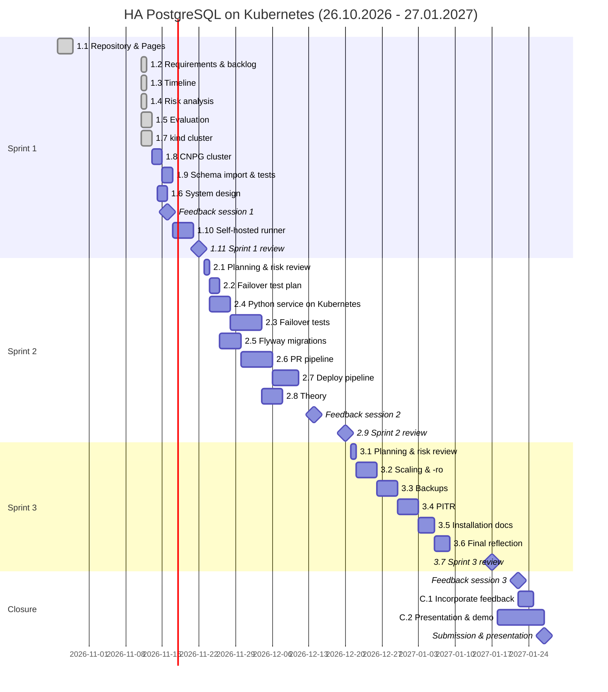

# 3.3 Timeline

## Gantt Chart (Planned)

## Story Points per Sprint

| Phase | Planned | Actual |
|---|---|---|
| Sprint 1 | 37 | |
| Sprint 2 | 39 | |
| Sprint 3 | 24 | |
| Closure | 5 | |
| **Total** | **105** | |

Sprint 3 is planned lighter because it includes the Christmas holidays (R8).
